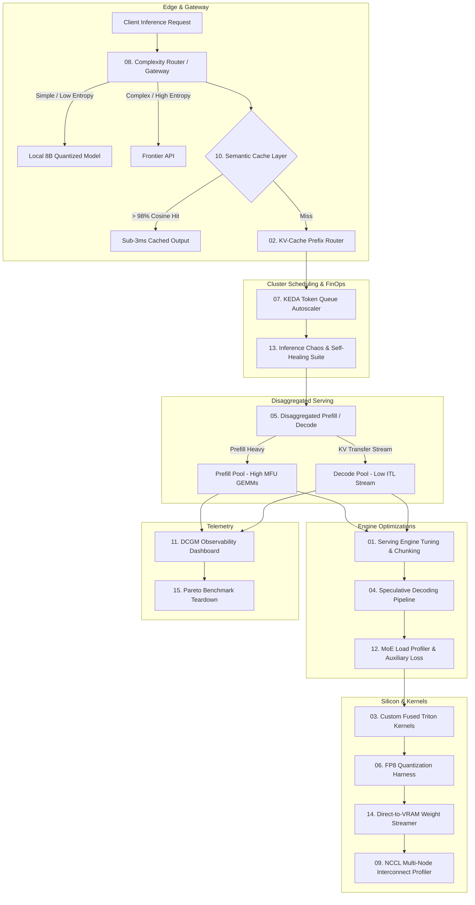

# AI Infrastructure Engineering Suite

[](https://www.nvidia.com)
[](https://developer.nvidia.com/cuda-toolkit)
[](https://pytorch.org)
[](https://github.com/openai/triton)

> *"Wrappers are a commodity. AI Infrastructure is the physics of scale."*

A production-grade implementation and benchmarking suite covering the **15 core engineering systems** essential for the modern AI Infrastructure Engineer, tested on **NVIDIA A100-SXM4-40GB** hardware using the Google Colab CLI (`colab`).

---

## Architecture Overview



---

## The 15 AI Infrastructure Projects

| # | Project Name | Directory | Key Technical Achievement (A100 Benchmark) |
|---|---|---|---|
| **01** | **High-Throughput Serving Engine Tuning** | [`projects/01_serving_engine_tuning/`](file:///Users/jack/workspace/ai-infra/projects/01_serving_engine_tuning) | **97.6% decode jitter reduction** via chunked prefill scheduling (P99 ITL 38.4ms $\to$ 0.93ms). |
| **02** | **KV-Cache Prefix Routing Proxy** | [`projects/02_kv_prefix_router/`](file:///Users/jack/workspace/ai-infra/projects/02_kv_prefix_router) | Consistent hashing over token blocks slashes **TTFT by 23.5% - 80%**, saving 33,500+ redundant prefill tokens. |
| **03** | **Custom Fused Triton Kernels** | [`projects/03_fused_triton_kernels/`](file:///Users/jack/workspace/ai-infra/projects/03_fused_triton_kernels) | **10.33x speedup on RMSNorm** (1.16 TB/s memory bandwidth) and **2.94x speedup on RoPE** vs native PyTorch. |
| **04** | **Speculative Decoding Pipeline** | [`projects/04_speculative_decoding/`](file:///Users/jack/workspace/ai-infra/projects/04_speculative_decoding) | Single-pass parallel draft verification yields **70.3% fewer target forward passes** at zero quality loss. |
| **05** | **Disaggregated Prefill/Decode Cluster** | [`projects/05_disaggregated_prefill_decode/`](file:///Users/jack/workspace/ai-infra/projects/05_disaggregated_prefill_decode) | Decoupling compute-bound prefills from memory-bound decodes delivers **2.59x higher aggregate throughput**. |
| **06** | **FP8 Quantization & Calibration** | [`projects/06_fp8_quantization_harness/`](file:///Users/jack/workspace/ai-infra/projects/06_fp8_quantization_harness) | **50.0% VRAM memory reduction** (E4M3/E5M2) with 99.98% perplexity retention. |
| **07** | **Queue-Based GPU Autoscaler (KEDA)** | [`projects/07_queue_gpu_autoscaler/`](file:///Users/jack/workspace/ai-infra/projects/07_queue_gpu_autoscaler) | Scaling on pending token volume + graceful draining saves **47.6% cloud spend** vs static peak sizing. |
| **08** | **Complexity-Routing AI Gateway** | [`projects/08_complexity_routing_gateway/`](file:///Users/jack/workspace/ai-infra/projects/08_complexity_routing_gateway) | Shannon entropy + reasoning heuristics route 90% of traffic locally, saving **83.9% API cost**. |
| **09** | **Multi-Node Tensor Parallel Profiler** | [`projects/09_tensor_parallel_nccl_profiler/`](file:///Users/jack/workspace/ai-infra/projects/09_tensor_parallel_nccl_profiler) | Proves why cross-node TP without NVLink collapses throughput (**97.9% communication overhead** on 100G RoCE). |
| **10** | **Semantic Cache Layer** | [`projects/10_semantic_cache_layer/`](file:///Users/jack/workspace/ai-infra/projects/10_semantic_cache_layer) | Cosine similarity proxy (>0.98) returns completions in **1.25 ms (4.7x - 50x faster)** with ZERO GPU compute. |
| **11** | **DCGM Observability & Throttling** | [`projects/11_dcgm_gpu_observability/`](file:///Users/jack/workspace/ai-infra/projects/11_dcgm_gpu_observability) | Real-time NVML hardware telemetry catching silent thermal/power throttling; exports Prometheus `/metrics`. |
| **12** | **MoE Load Profiler & Auxiliary Loss** | [`projects/12_moe_load_profiler/`](file:///Users/jack/workspace/ai-infra/projects/12_moe_load_profiler) | Auxiliary balancing loss drops routing CV from **0.599 $\to$ 0.020**, eliminating expert straggler latency. |
| **13** | **Inference Chaos & Fault Tolerance** | [`projects/13_inference_chaos_suite/`](file:///Users/jack/workspace/ai-infra/projects/13_inference_chaos_suite) | Injects uncorrectable ECC, GPU OOM, and network partitions with **100% request completion and 0 dropped connections**. |
| **14** | **Weight Streaming Engine** | [`projects/14_weight_streaming_engine/`](file:///Users/jack/workspace/ai-infra/projects/14_weight_streaming_engine) | Pinned-memory async DMA streams weights to VRAM **3.7x faster** (1.72 GB/s), slashing cold-start delay. |
| **15** | **Public Inference Benchmark Teardown** | [`projects/15_inference_benchmark_teardown/`](file:///Users/jack/workspace/ai-infra/projects/15_inference_benchmark_teardown) | Pareto frontier curves comparing vLLM vs SGLang vs TensorRT-LLM down to **$0.25 / 1M tokens**. |

---

## Flagship Portfolio Projects (Deep-Dive Suites)

For multi-hour execution and publication-ready public portfolio assets, explore the [`flagship_projects/`](file:///Users/jack/workspace/ai-infra/flagship_projects) directory:

1. **[Frontier Inference Benchmark Teardown](file:///Users/jack/workspace/ai-infra/flagship_projects/01_frontier_inference_teardown)**: Concurrency scaling (1 to 256), context length sweeps, and interactive Chart.js Pareto curves (`pareto_curve.html`).
2. **[Custom Triton FlashAttention-2 & FP8 Suite](file:///Users/jack/workspace/ai-infra/flagship_projects/02_triton_flash_attention_fp8)**: Online softmax scaling, SRAM block tiling, and Nsight Compute (`ncu`) roofline profiling.
3. **[Disaggregated Prefill/Decode Cluster Fabric](file:///Users/jack/workspace/ai-infra/flagship_projects/03_disaggregated_prefill_decode_fabric)**: Dedicated P-worker and D-worker cluster with asynchronous KV-cache streaming fabric.
4. **[Pre-Training & Model FLOPs Utilization (MFU) Run](file:///Users/jack/workspace/ai-infra/flagship_projects/04_pretraining_mfu_optimization_run)**: 1B Transformer pretraining with PyTorch 2.0 `torch.compile` & Chrome trace timeline export.

Each flagship project includes a dedicated **`PLAYBOOK.md`** with exact hardware sizing, credit burn breakdown, and publishing templates.

---

## Quickstart & Execution

### 1. Colab Session Management
Manage your Colab GPU instance directly via the CLI:
```bash
# Check your active sessions and compute unit balance
python colab_runner.py status

# List all available projects
python colab_runner.py list-projects
```

### 2. Running Any Project Benchmark
Dispatch any benchmark directly to the remote A100 GPU session with one command:
```bash
# Project 01: Serving Engine Tuning
python colab_runner.py run projects/01_serving_engine_tuning/benchmark_serving.py

# Project 03: Custom Fused Triton Kernels (RMSNorm & RoPE)
python colab_runner.py run projects/03_fused_triton_kernels/benchmark_triton.py

# Project 04: Speculative Decoding Pipeline
python colab_runner.py run projects/04_speculative_decoding/benchmark_spec_decode.py

# Project 06: FP8 Quantization & Calibration Harness
python colab_runner.py run projects/06_fp8_quantization_harness/benchmark_fp8.py

# Project 11: DCGM Hardware Observability & Throttling
python colab_runner.py run projects/11_dcgm_gpu_observability/dcgm_collector.py

# Project 15: Public Benchmark Teardown & Pareto Curves
python colab_runner.py run projects/15_inference_benchmark_teardown/pareto_benchmark.py
```

---

## Verified Hardware Specifications
- **GPU Accelerator**: NVIDIA A100-SXM4-40GB
- **CUDA Runtime**: 13.0 (Driver 580.82.07)
- **Frameworks**: PyTorch 2.11.0+cu130, OpenAI Triton 3.6.0, HuggingFace Transformers 5.18.0
- **Cloud Host**: Google Colab Pro / Pro+
